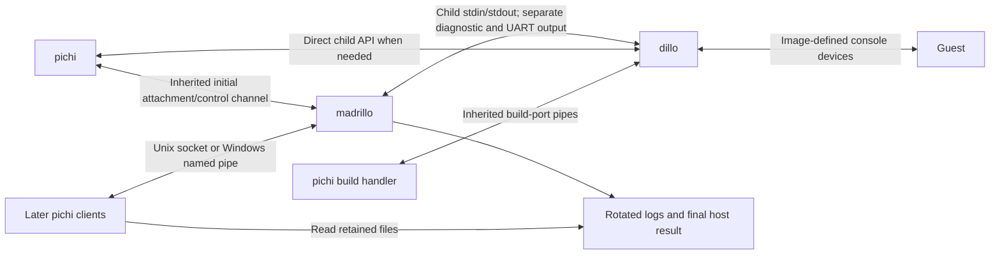

# Terminal architecture for pichi

Historical research. The current implementation scope is in [PLAN.md](../../PLAN.md).

Architecture proposal and prior-art research, 2026-11-05. The madrillo repository
and implementation have not been created.

Give each workload one small **madrillo** monitor. A workload has a launched
leader and may contain descendant processes. Pichi owns the user interface;
madrillo owns supervision and byte streams; dillo owns the VM.
Foreground and detached runs use the same process tree and I/O ownership.

The initial attachment is established by a connected native channel inherited
by madrillo at spawn. It is separate from native stdin/stdout/stderr so that
conmon-style stdio passthrough remains possible.
Madrillo launches the workload only after required native placement is complete.
Initial attachment itself needs no handshake or replay backlog. External
placement can require a start gate, and atomic native containment may require
suspended creation. Later clients attach through a native local endpoint.
Historical output lives in the configured log destination.

## Ownership and scope

| Owner | Responsibilities |
| --- | --- |
| Pichi | Images, instance discovery, launch settings, terminal UI, log reading, interpretation of dillo results, deletion |
| Madrillo | Workload supervision, pipe or terminal capture, live attachment, input ownership, conmon-compatible logging, host results, workload termination, generic notification relay and exit hook |
| Dillo | VM devices, console bytes, console-loss cleanup, supported guest resize/shutdown operations |
| Guest | Terminal line discipline, shell, process groups, guest application behavior |



Madrillo launches an ordinary executable with native arguments, environment,
and working directory. It needs no cooperating management API and contains no
VM knowledge. Child-specific endpoints remain a contract between pichi and
dillo: madrillo neither opens those connections nor interprets their traffic.

Conmon's generic supervision functions are the baseline, including descendants,
logging, runtime deadlines, notification relay, cleanup, placement, OOM evidence,
and shutdown synchronization. Evaluate and qualify optional host PTY/ConPTY
support; dillo's VM console continues to use pipes. Guest command execution,
OCI runtime adapters, remote APIs, automatic restart policy inside madrillo,
and monitor replacement remain outside scope.

The [conmon coverage audit](CONMON-COVERAGE.md) specifies these requirements,
the terminal recommendation, native limitations, and remaining qualification
work. In particular, complete descendant containment on macOS is unresolved;
it must not be represented as already solved by process groups.

## Package boundary and safe code

Use one `madrillo` repository and one Cargo package producing a library and a
binary, following Conglobate. The library MUST be bare bones: only shared
message/record types and necessary serialization derives. No client SDK,
transport, CLI parser, process implementation, logging code, or dillo API types.
Keep all implementation in private binary modules, including platform code.
Set `default = []`; require `cli` for the binary and gate its runtime dependencies
behind that feature. Pichi imports the library without `cli`. Check the actual
dependency tree, not just the size of `lib.rs`.

Every madrillo-owned target declares `#![forbid(unsafe_code)]`, with no platform
exceptions or project-local unsafe shim. Use sound safe APIs from std or
qualified dependencies. The lint does not assert that dependencies contain no
unsafe internals. [Rust unsafe operations][rust-unsafety], [lint levels][rust-lints].

Every production panic is a defect. Operational failures use typed errors;
production `unwrap`, `expect`, panic macros, and runtime assertions are not error
handling. Bound allocation, frame sizes, queues, and client counts. Check lengths
and arithmetic. Malformed clients, child exit, full disks, and broken pipes must
not crash the monitor. A client failure affects that client; a logging failure
follows the policy below. Fuzz framing and inject I/O failures. Safe Rust and
blanket panic catching do not establish reliability. [Rust panics][rust-panics].

## Madrillo CLI and initial attachment

```text
madrillo --control <HANDLE> --listen <ENDPOINT> --state-dir <DIR>
         [--stdin] [--terminal] [--size <ROWS>x<COLS>] [--timeout <SECONDS>]
         [--start-gated]
         [--capture <NAME>=<HANDLE>]... [--inherit <HANDLE>]... [--hold <HANDLE>]...
         [--log-path <DRIVER[:PATH]>]... [logging options]
         [--sdnotify-socket <PATH>]
         [--exit-command <PROGRAM>] [--exit-command-arg <ARG>]... [--exit-delay <SECONDS>]
         -- <PROGRAM> [ARG...]
```

| Option | Purpose |
| --- | --- |
| `--control` | Inherited connected duplex channel for initial attachment, placement gate, and launch/result reporting |
| `--listen` | Private reconnect endpoint: Unix stream socket on Linux/macOS, local named pipe on Windows |
| `--state-dir` | Private instance directory for logs and the final host result |
| `--stdin` | In pipe mode, create and retain child stdin; otherwise supply EOF |
| `--terminal`, `--size` | Proposed opt-in host PTY/ConPTY with an initial size; pipes remain the default |
| `--timeout` | Monitor-enforced monotonic workload deadline; unset/zero disables it |
| `--start-gated` | Wait for launch authorization after external placement, using the existing initial connection |
| `--capture NAME=HANDLE` | Capture an additional inherited read end, such as UART output |
| `--inherit HANDLE` | Pass an opaque inherited resource to the child unchanged, then close the monitor's copy |
| `--hold HANDLE` | Retain an opaque monitor-only resource until workload cleanup, without passing it to the child |
| `--log-path` and logging options | Conmon-compatible destinations, limits, rotation, metadata, and synchronization policy; see the coverage audit |
| `--sdnotify-socket` | Relay allowed standard service notifications to the configured host destination where supported |
| `--exit-command`, arguments, delay | Invoke one native command after workload exit; caller owns its policy |
| `--` | Native child executable and arguments |

Resource options are for extra streams, the existing build pipes, and held
reservations, not required for a normal stdio-only child. Keep `--listen` and
`--state-dir` distinct: native endpoint naming and retained storage have different
constraints. Pichi sets environment and working directory through the process
API. Preserve native OS argument/path values; do not build a shell command or a
second serialized launch specification. Madrillo needs no VM flags, environment
DSL, or daemonization subcommand. This CLI is a revised draft; safe ownership
of the inherited channel and native placement arguments need qualification as described
in the audit. [Rust arguments][rust-command].

Pichi creates a connected native channel and passes one endpoint to madrillo:
a Unix socketpair endpoint on Linux/macOS, or a connected duplex named-pipe
handle on Windows. `--control` identifies that already-inherited resource; the
number alone is not a transfer. Madrillo's own diagnostics use a separate file.
This is a programmatic monitor executable; pichi is the terminal frontend.

For captured mode, workload stdio uses monitor-owned pipes or a terminal.
Passthrough instead inherits madrillo's native stdio, which pichi prepares as
the desired destinations. Protocol frames never share those descriptors. This
replaces the earlier use of madrillo stdin/stdout as the initial protocol and
avoids a second passthrough-specific mapping of all three standard streams.
Terminal mode creates a terminal input endpoint independently of a client's
input attachment. Passthrough and monitor-created terminal mode are distinct
I/O choices; do not silently combine them. The control endpoint never enters
the workload inheritance list.

Madrillo prepares logging and its reconnect endpoint, registers the initial
output subscriber, then completes placement and spawns the child using separate
stdio pipes, the requested terminal, or native passthrough. The
invocation authorizes that one launch. It reports host launch success/failure,
then output frames and completion. Source tags let pichi render the chosen
stream. Early output has a recipient even before pichi reads it. Ordinary
bounded-client limits still apply to an indefinitely stalled launcher.

Foreground pichi stays connected. Detached pichi reads host launch success,
prints the instance ID, and closes the attachment. After launch authorization,
client loss does not cancel the workload. A lost response means inspect that
instance, not blindly launch another.

When external placement is required, `--start-gated` makes madrillo report
`Prepared`, then wait for `Start` on the existing initial connection. Pichi
finishes monitor placement and resource preparation before sending it. EOF
before `Start` cancels the unlaunched instance and releases its resources;
after `Start` it is only client loss. No separate bootstrap channel or replay
service is needed. An ungated launch is valid only when the supplied native
setup can establish all required placement before workload code executes.

`run -d` promises host process launch, not guest boot or health. A later dillo
failure appears in logs and wait. Do not create a dillo readiness service just
for this command. A configured standard notification relay does not change this
meaning or synthesize `READY=1`. Dillo-specific readiness remains a direct child
API; build already waits for its guest-initiated request.

The preconnected-channel argument does not replace conmon's manager-controlled
cgroup placement wait. The start gate establishes ordering; it does not itself
place the child into a different cgroup/job. That native spawn boundary must
also prevent execution and descendant creation before membership is established.

## Extra resource ownership

Use ordinary process stdin/stdout for dillo's primary console and stderr for
its diagnostics. The existing port-0 `stdio` backend can refer to these pipes;
it does not need a new endpoint syntax just to move terminal ownership to pichi.
UART needs a separate captured output stream. Madrillo knows only stream names;
pichi maps those names to VM devices.

Extra inherited resources have three roles: captured read ends, opaque child
resources, and resources held only by the monitor. Pichi explicitly selects what madrillo
inherits. It supplies final native values in madrillo's and the child's arguments.
Madrillo passes child resources unchanged and never rewrites child-specific
arguments. Held resources close after workload cleanup and before final completion
notification. Reject duplicate roles, stdio collisions, and wrong directions. A
serialized integer alone cannot transfer an OS resource.

Close pichi's transferred copies after monitor spawn, and madrillo's child-only
copies after child spawn. Never pass a monitor-owned writer to the child; leaked
copies would mask monitor death. Use an explicit child inheritance allowlist
on every platform. [Windows inheritance][windows-inheritance],
[handle transfer][windows-handle-transfer].

**Native qualification required:** acquiring inherited resources as owned Rust
objects and forwarding the exact allowlist must work through safe APIs on all
three hosts. The documented `command-fds` receiver initialization requires an
unsafe call even though its sending API is safe; it is not sufficient by itself.
Windows process-attribute APIs have toolchain constraints too. Qualify the
whole boundary before implementing it. Do not add an unsafe shim, inherit all
handles, or replace the locked build transport to evade this requirement.
[Command-fds API][command-fds], [Rust Windows process API][rust-windows-command].

## Attachment and input

Use one fixed-version bounded frame format over the inherited initial channel and later native
connections. Necessary operations are attach, input bytes, input release,
explicit pipe-input closure, terminal resize, log reopen, wait, forced workload
termination, and gated `Start` when requested. Responses carry output bytes,
preparation/launch results, completion, and errors. Reject unknown versions
and oversized frames. No general executable-launch RPC, logs RPC, capability-negotiation framework,
resumable sessions, or resource broker is needed. The initial connection is
already an output subscriber; later connections request an attachment.

Closing a connection detaches it. Input ownership belongs to that connection;
there is no detach request, lease token, heartbeat, or takeover protocol. Allow
bounded output observers and at most one input owner. `Attach` can claim input;
a competing claim fails. `InputEnd` releases input while output continues.
`CloseInput`, accepted from the input owner, closes pipe-backed stdin permanently.
It is unsupported for terminal-backed stdin: terminal EOF bytes and terminal
destruction are not a pipe half-close. Terminal resize is also restricted to
the input owner; observers do not compete over size.
Client EOF and disconnect never implicitly invoke `CloseInput`.

Pichi always enables child stdin for managed dillo, even for `run -d` and without
`-i`. The monitor retains that writer without clients. Pichi's `-i` selects input
for this attachment; it does not change the child's lifetime. Extra captured
streams are output-only, so selecting UART cannot duplicate console input.
Input queues are bounded and use backpressure; do not silently drop accepted
input. Slow I/O must not block the supervisor or other control connections.

After launch authorization, initial channel loss releases that client's input
ownership and attachment. The child stdin writer remains open. Before a gated
Start it cancels the unlaunched workload. The pichi-to-madrillo connection and
the madrillo-to-dillo console pipe have distinct ownership.

## Pichi CLI and terminal behavior

Use one attachment implementation for run and attach.

| Operation | Behavior |
| --- | --- |
| `pichi run IMAGE` | Launch, display primary console output, wait; leave stdin and host terminal modes alone |
| `pichi run -d IMAGE` | Return the instance ID after host launch success |
| `pichi run -i IMAGE` | Also copy input bytes; leave terminal modes alone |
| `pichi run -it IMAGE` | Also use native raw terminal handling, resize, and detach keys |
| `pichi attach ID` | Attach live with input; use terminal handling when local input and output are terminals |
| `pichi attach --no-stdin ID` | Observe live output only |
| `pichi logs [-f] ID` | Read/follow the configured retained destination; no input or terminal handling |
| `pichi wait ID` | Return the retained host result, interpreted through the dillo contract |
| `pichi stop [--force] ID` | Request supported shutdown directly from dillo; explicit force terminates the workload through madrillo |

The same `--stream NAME` selection on run, attach, and logs maps `console`,
`uart`, and `diagnostics` to captured sources; `console` is the default. Reject
input requests for an output-only source. Reattach is live-only. Read history
with logs; there is no combined replay-and-attach mode.

On run, `-t` requires `-i` and terminal input/output. Reject `-d` combined with
input/terminal flags. On attach, `--no-stdin` disables raw mode, piped input uses
ordinary copying, and explicit `-t` requires terminals. `-t` configures the local
attachment, not a guest PTY. Guest line discipline may echo or translate input,
so `-i` is not a binary guest-command pipe. Escape parsing applies only to
terminal sessions, handles split reads, and supports `--detach-keys` including
a disable value.

| Event | Effect |
| --- | --- |
| Ctrl-C / Ctrl-D in raw interactive mode | Forward bytes `0x03` / `0x04`; the guest interprets them |
| Detach keys | Close attachment and restore local terminal; VM continues |
| Client input EOF | Release input; retain output and the child's input pipe |
| CLI crash / connection loss | Release attachment; VM continues |
| Ctrl-C during logs or output-only attach | Cancel observation; VM continues |
| Host cancellation during foreground run | Use the same supported shutdown operation as `stop` |
| Guest poweroff / dillo exit | Record native host status; pichi interprets the dillo result |

Unsupported graceful shutdown reports that fact and leaves the VM running;
return its ID on foreground cancellation. Never silently turn graceful stop
into forced termination. Raw Ctrl-C goes to the guest; host signal/console-event
handling belongs to pichi. No generic signal-proxy framework belongs in madrillo.

Pichi restores host terminal state after ordinary exit, detach, startup error,
and handled termination. Forced death bypassing cleanup cannot restore it.
Foreground stdout contains selected console bytes; detached stdout contains
only the ID. Progress and diagnostics remain separate.

Resize goes directly from the input-owning pichi client to dillo. Dillo retains
the latest size until the guest can consume it, using virtio-console size/config
notifications or MULTIPORT resize events as appropriate. UART has no equivalent
generic resize; report unsupported behavior. Host terminal negotiation does not
set the guest's `TERM`. Preserve image-defined devices, port 0, MULTIPORT layout,
DTB, and measured command line. [Virtio console][virtio-console-spec],
[dillo rules](../dillo/DESIGN-RULES.md),
[named-port contract](../dillo/deps/dillo-virtio-console/DESIGN-named-ports.md).

## Logs and completion

Match conmon's logging functions: Kubernetes/CRI file records, journald where
available, disabled logging, passthrough, supported combined destinations,
size/global limits, rotation/truncation, metadata, external reopen, and shutdown
synchronization. Do not invent a replacement transcript format. The library
still has no logging implementation. The [coverage audit](CONMON-COVERAGE.md)
defines compatibility details and passthrough's effect on attachment.

File records preserve payload bytes and conmon's stdout/stderr and partial/full
markers. Additional sources use separate source-named files rather than invalid
CRI stream names. Journald metadata identifies additional sources. Pichi reads
the configured file or journal; `none`/passthrough supply no retained history.
No logs RPC, database, replay cursor, or duplicate in-memory history is needed.

The former drop-on-queue-full logging default is withdrawn. Use bounded
backpressure for a slow healthy sink; report write failures and explicit caps.
Conmon does not promise lossless logging through disk failure. Isolate blocking
sink work so control/deadline handling remains responsive, and disconnect slow
viewers independently. Dillo's console-device overflow policy is a separate
boundary: bounded memory, uninterrupted execution, and lossless output under
an indefinitely blocked sink cannot all be promised. Do not silently attribute
device-level loss to successful monitor logging. Build pipes remain independent.

File following uses normal file positions and rotation identity; report retention
overrun. Retry incomplete records while the writer lives and report truncation
after finalization. Completion or monitor loss ends following after available
data drains. Order is the monitor's observation, not a total order of guest writes.

Retain the leader's native exit result, then finish workload cleanup, bounded
output drain, and log synchronization before publishing final completion. Reap
adopted children where the OS permits it. A surviving helper is a cleanup
responsibility, not merely an output pipe to abandon. Cleanup/drain/sync failure
is reported without replacing the known leader status or declaring success.
Default file synchronization matches conmon; an explicit `--no-sync-log` opts
out. Atomic result publication and requested native file/directory flushing
must be specified separately; no promise extends to every record before a crash.

The result distinguishes spawn failure from native leader exit, preserving Unix
signal termination and full Windows exit codes. It also records timeout, OOM
evidence/availability, cleanup outcome, logging/sync errors, and exit time.
`wait` obtains that result from
the live monitor or retained file. There is no reconstruction from logs or
separate status service. If persistence fails, report it to connected clients;
a later missing result means unknown, never success. Guest application exit
status and richer VM reasons remain outside madrillo's host result.
[Rust completion][rust-exit-status], [Windows exit status][windows-exit-status].

## Native lifetime and monitor loss

Native Linux, macOS, and Windows MSVC are mandatory from the first release.
Use private platform modules. Linux cgroups/subreaping/OOM observation and
Windows jobs have platform-specific implementations; do not imply that a
process group provides equivalent containment on macOS.

| Concern | Linux and macOS | Windows |
| --- | --- | --- |
| Reconnect | Private Unix stream socket | Local named pipe with explicit user ACL |
| Child I/O | Native process pipes and explicit inherited descriptors | Native pipe handles and explicit inheritance list |
| Optional terminal | Host PTY, controlling terminal, resize | ConPTY, resize, native teardown rules |
| Monitor independence | Separate session; no inherited terminal | Console-independent launch; deliberate job membership |
| Terminal UI in pichi | Native modes and resize events | Native console modes, input, and resize events |

Use ordinary safe process/pipe APIs and isolate blocking I/O from the state
owner. Do not write a custom cross-platform reactor or introduce public backend
traits. On Unix a safe `setsid` call in the new monitor before child launch
avoids madrillo-owned fork/pre-exec code; fail startup if detachment fails. No
double-fork is needed. On Windows a new process group alone is insufficient;
respect job breakaway restrictions and fail an unsupported lifetime setup.
[Safe session creation][safe-setsid], [Windows process flags][windows-process-flags],
[job lifetime][windows-jobs], [pipe ACLs][windows-pipe-security],
[console modes][windows-console-mode].

Supervise a workload scope, with the monitor outside workload resource limits.
Linux uses an appropriate cgroup and subreaper role; Windows uses a Job Object
with membership established before workload execution. Pichi owns resource
policy and prepares any required service-manager placement. macOS cooperative
process-group/session handling needs a precise contract and native proof;
escaping descendants and terminal job-control groups are unresolved, not silently
excluded. Scope termination and root-exit cleanup must cover helpers.

`--timeout` is enforced by madrillo using a monotonic clock from successful
workload launch. On expiry, force the workload to stop and retain a timeout
reason, following conmon's hard-deadline behavior. It is independent of client
attachment and output-drain deadlines. It does not invent a dillo shutdown API.

Pichi chooses fresh private instance paths, owns discovery/deletion, and protects
resources used by running VMs from prune. Transient endpoints belong under its
runroot; retained logs/results belong under its storage layout. Madrillo has
no registry or garbage collector. A PID in metadata is diagnostic: forced
termination uses the live workload scope and owned process handles, never a
stale PID recovered from disk.

Live-resource cleanup cannot depend on the launching pichi still being present.
Assign each such resource to dillo, madrillo, or another existing owner whose
lifetime is sufficient; retained files may await pichi inspection/removal.
Madrillo also supports one native exit command with literal arguments, following
conmon. Pichi can supply an idempotent cleanup command that reads retained state;
the monitor does not implement pichi policy. No shell expansion or hook framework
is needed. A killed monitor cannot execute the callback, so pichi must reconcile
uncompleted cleanup on later inspection. The audit specifies ordering and limits.

On Linux, observe workload cgroup memory events and attempt monitor OOM-score
protection without passing that protection to the workload or exit helper.
Permission failures and unavailable observation remain visible. Other hosts
report available native resource-limit evidence; an unexplained kill remains
unknown. No equivalent Linux OOM diagnosis is invented for macOS/Windows.

An optional standard `sd_notify` relay forwards conmon's allowed readiness,
status, stopping/reloading, and watchdog fields to the host service manager.
It does not generate readiness or watchdog heartbeats, forward arbitrary child
API traffic, or implement guest execution. Service-manager identity and access
must be valid. Linux systemd integration is platform-specific, not a dependency
of ordinary launches on macOS or Windows.

Dillo chooses console-loss cleanup through its own launch policy. Only madrillo
retains the host-to-dillo stdin writer after handoff. Monitor death closes it
through the OS even without a destructor or last message. Client EOF/detach,
Ctrl-D data, and guest console closure leave it open. Unrecoverable host-console
failure also requests cleanup even if madrillo still lives.
[Unix pipe lifetime][unix-pipe-lifetime], [Windows pipe lifetime][windows-pipe-lifetime].

**Native qualification required:** dillo must detect this closure before and
during VM execution even when the guest does not read and input buffers are
full. EOF observed only after buffers drain is insufficient. Existing named-port
workers do not establish this behavior. Test the native hangup/disconnection
mechanism on all three hosts; do not infer it from an empty-pipe test. There is
no heartbeat or separate liveness/control protocol in this design. Console-free
launches without a suitable persistent transport need a lifetime decision before
claiming this guarantee.

Dillo cleanup stops VM execution, coordinates its helpers, and performs its defined device/host-I/O cleanup
without waiting on a dead console sink. This does not guarantee orderly guest-OS
shutdown. Immediate parent-death kills or Windows kill-on-close jobs must not
preempt cleanup. A dead monitor cannot enforce escalation if dillo hangs. No
watchdog/restart service is introduced. Independence from CLI exit does not
promise survival across host reboot or administrative session/job cleanup.

## Build contract and acceptance

`pichi build` reuses supervised process launch. Preserve its exact
`dev.pichi.build` bidirectional inherited `rx=pipe:N` / `tx=pipe:N` transport,
v0 CBOR exchange, guest-request-before-host-response ordering, and virtiofs
repo/cache/output contract. Madrillo passes child resources and closes its
copies; it neither proxies nor logs that traffic. Build cancellation policy
remains with pichi. No guest exec API or build-protocol redesign is introduced.
[Build contract](BUILD.md).

Qualify safe native resource ownership, scope placement, descendant cleanup,
PTY/ConPTY composition, and full-buffer console-loss detection before committing
to their implementation. Then implement the generic monitor
with ordinary fixture children, integrate dillo console cleanup/output, and
share run/build launch. Add supported guest resize/shutdown at the direct dillo
boundary. Do not ship detach without discovery, logs, wait, and force stop.

| Acceptance case | Required result |
| --- | --- |
| Ordinary child with no management API | Launch, capture, attach, input, wait, and force termination work |
| Minimal library build and every owned target | No binary runtime dependency leakage; `forbid(unsafe_code)` enforced |
| Malformed frames, broken clients/pipes, storage failure | Defined errors and bounded resources; no production panic |
| Immediate output and immediate exit | Inherited initial attachment receives first/last bytes under normal bounds; final result follows drain |
| Foreground, detached, and CLI killed during startup | Authorized workload survives client loss; gated pre-Start EOF launches nothing |
| Initial connection loss and later reattach | Live attachment works; history is available in retained files |
| Concurrent viewers and competing input owners | Bounded observers; at most one writer; ownership releases on disconnect |
| Input EOF, Ctrl-D, detach, monitor loss | Distinct documented effects; only actual host-console loss requests dillo cleanup |
| Monitor forcibly killed with buffers empty/full and guest not reading | Dillo detects loss and enters cleanup on every native host |
| Extra-resource handoff | Exact allowlists; no writer leaks; child APIs remain direct |
| Log formats/drivers, rotation/reopen, caps, full disk, stalled sink | Conmon-compatible records and configured behavior; bounded memory, visible errors, responsive control |
| Leader exits while helpers survive or hold output pipes | Workload cleanup is attempted; leader status retained; cleanup/truncation failures explicit |
| Force stop and timeout after launcher exit | Entire supported workload scope targeted; timeout retained separately from native exit |
| Placement and rapid fork at startup | No workload code runs before required cgroup/job membership |
| OOM events and permission denial | Evidence recorded accurately; absent evidence never inferred from SIGKILL |
| PTY/ConPTY shell, job control, resize, detach/reattach | Terminal survives viewers; native semantics preserved; descendant cleanup qualified |
| Notify relay and socket activation | Allowed notifications only; valid service attribution and descriptor/PID semantics |
| Exit hook, monitor-held reservation, monitor death | Ordered release and callback; crash limitations and later reconciliation explicit |
| Log/result synchronization error | Known exit retained with failure; no false claim of durability |
| Native paths/arguments and exit status | Preserve spaces, non-ASCII/native strings, Windows codes, Unix signal termination |
| Terminal enter/exit, fragmented escape sequence, resize | Correct native behavior and restoration; unsupported guest capabilities reported |
| Monitor/result unavailable or stale metadata | Unknown outcome; no fabricated success or stale-PID termination |
| Build integration | Existing inherited pipes, CBOR, device model, and request ordering unchanged |

Run generic fixtures natively on Linux, macOS, and Windows MSVC; they need no
hypervisor. Keep real dillo boot/device checks separate under the existing
[platform matrix](PLATFORMS.md). Cross-compilation is not native qualification.
This review changes the design only; it does not claim these runtime tests pass.

## Prior art and original source observations

**Evidence and scope.** The comparison below covers Linux containers, local
Podman, Docker’s client/server path, and Podman’s remote attach adaptation.
Implementation claims use the following upstream snapshots. Runtime observations
use the installed Podman 5.8.7, conmon 2.2.1, and cached Alpine 3.23 image, with
networking disabled and no pulls. Docker was examined through its source and API
contract; no Docker runtime experiment was performed. Upstream Podman here is a
v6 development snapshot, so its source and the installed v5 observations are
identified separately where relevant.

| Component | Source revision |
| --- | --- |
| Docker CLI | `949b412ae32945a741d750ed6230c5566983270a` |
| Moby Engine | `b3b7197adfc8f056dd50b74317ed3c26d1abb82f` |
| containerd | `79e23749d4840f5f12d7b4fc54147479f2254f96` |
| runc | `48dfb3a2c0bc9967074e04609493a500120ba018` |
| Podman | `8d37a39bb1cc07a1425996a8adf24be9213d2f4c` |
| conmon | `46837cd4800889521b6eccd4cce75a69249b1702` |
| OCI runtime specification | `469dd5b6233c9d0137d16be792978aebb302666e` |

**The user-facing choices are independent.** Both tools distinguish creating a
terminal, making stdin available, selecting streams to attach, and waiting in
the foreground. Neither allocates a container TTY just because the command is
run from a terminal. [Docker option processing][docker-opts],
[Podman run documentation][podman-run-doc].

| Invocation | Container terminal | Input | Client behavior |
| --- | --- | --- | --- |
| `run IMAGE CMD` | None | Not connected by default | Stream stdout/stderr separately and wait |
| `run -i IMAGE CMD` | None | Make stdin available and attach it | Suitable for process pipelines |
| `run -t IMAGE CMD` | Allocate PTY | Does not by itself request CLI input attachment | Combined terminal output |
| `run -it IMAGE CMD` | Allocate PTY | Attach input | Interactive terminal session |
| `run -d IMAGE CMD` | Independent of `-d` | Independent of `-d` | Return container ID after starting |
| `run -dit IMAGE CMD` | Allocate PTY | Keep input available | Return ID; attach later |
| `attach ID` | Use the existing setting | Subject to creation settings and `--no-stdin` | Connect to the existing process |
| `exec -it ID CMD` | Allocate a new process PTY | New process input | Start an additional process |

For non-TTY operation, `-i` controls a real process stdin pipe. With a TTY,
descriptors 0, 1, and 2 refer to the terminal slave, even when the CLI does not
forward input. Thus “no input attachment” does not imply “fd 0 is not a TTY.”
The OCI contract makes terminal allocation a property of the created process;
its initial dimensions are a separate field. [OCI process specification][oci-process].

**Docker’s actual path.** The CLI translates options into persistent container
configuration, including `Tty`, `OpenStdin`, and `StdinOnce`, plus attachment
choices. Without `-a`, it selects stdout and stderr; `-i` adds stdin. Detached
run clears attachment flags and `StdinOnce`, while retaining `OpenStdin` and
`Tty`. [Option processing][docker-opts], [run implementation][docker-run].

`-a` selects attached streams; it does not itself allocate a PTY or establish
the persistent open-stdin policy. Docker rejects combining explicit `-a` with
`-d`. A later attachment uses the existing process configuration: it cannot
turn a running non-TTY process into a TTY process. A new `exec` session is the
way to request another process with its own terminal.
[Run validation][docker-run], [OCI process specification][oci-process].

For foreground run, Docker creates the container, establishes attachment and
exit waiting, then starts it. Attaching before starting prevents short-lived
commands from writing their entire output before a client is connected. Exit
notification and output completion are separate: the CLI drains output before
returning the workload’s status. Detach returns successfully without waiting for
the process to exit. [Run sequencing][docker-run].

On the Linux runc path, containerd’s shim creates either ordinary process I/O or
a console socket. For terminal mode, runc allocates the PTY in the container’s
environment, sends the master descriptor over the console socket, and duplicates
the slave onto the process’s standard descriptors. The shim receives and holds
the master; runc does not need to remain the interactive terminal frontend.
[Shim initialization][shim-init], [runc console setup][runc-console].

The shim copies PTY output or separate process pipes to the configured I/O
endpoints. Moby connects those endpoints to its stream broadcasters and logging
readers. Multiple attached clients receive copies of the same output, and their
input goes to the same underlying process input. The CLI does not own the
container’s PTY master. A shim may manage multiple containers; “exactly one shim
per container” is not a universal containerd rule.
[Shim console I/O][shim-console], [Moby stream ownership][moby-streams],
[containerd runtime architecture][containerd-runtime].

The Docker Engine attach API upgrades or hijacks an HTTP connection. Without a
TTY, output has an eight-byte header: stream identifier, three reserved bytes,
and a big-endian 32-bit payload length. This preserves stdout/stderr identity.
With a TTY, output is an unframed PTY byte stream: the streams have already
merged inside the terminal. Resize is a separate API operation, not a special
byte sequence embedded in output. Ordinary CLI attach requests live streaming;
the API also supports log replay. [Engine attach contract][docker-api],
[demultiplexer][docker-stdcopy], [terminal resize client][docker-tty].

**Podman’s actual path.** Local Podman uses libpod to prepare and start the
container, with conmon retaining the process’s I/O and recording its eventual
exit. Conmon normally daemonizes, invokes the OCI runtime, and remains after
the invoking Podman process exits. It supplies attach access and logging.
“Daemonless” therefore does not mean “there is no persistent supervising
process.” [Conmon architecture][conmon-readme].

For non-terminal operation, conmon creates separate pipes. Terminal operation
uses the runtime’s console socket to receive the PTY master. Conmon uses that
master for input and combined output. There is also a runtime error pipe, which
must not be confused with a separate stderr stream from a process whose three
descriptors are connected to the PTY. [Conmon initialization][conmon-main],
[console descriptor handling][conmon-control].

Local Podman attaches to conmon over a Unix `SOCK_SEQPACKET` socket. Output
messages carry a one-byte stream identifier followed by data; message boundaries
come from the socket. This is a different protocol from Docker’s eight-byte
framing. Input is copied toward the container. Libpod connects before requesting
start, and exec has an explicit attach/start synchronization handshake.
[Local attach implementation][podman-attach], [Linux socket connection][podman-attach-linux],
[conmon socket handling][conmon-sockets].

Podman sends resize requests through conmon’s `ctl` FIFO; conmon ultimately
applies `TIOCSWINSZ` to the PTY. Remote HTTP attachment translates conmon’s local
messages into raw terminal output or Docker-compatible multiplexed output.
Thus the local mechanism can remain simple without making it the public remote
wire contract. [Resize and HTTP adaptation][podman-conmon],
[conmon resize handling][conmon-control].

**Raw mode, signals, and detach are different mechanisms.** The client puts the
user’s terminal into raw mode so keystrokes can reach the target terminal. The
target terminal’s line discipline then interprets ordinary control characters.
For example, typed Ctrl-C normally travels as byte `0x03` and causes the target
terminal to signal its foreground process group, provided its terminal settings
enable that behavior. It is not an unconditional kill operation.
[Docker terminal streamer][docker-hijack], [Podman terminal setup][podman-terminal],
[runc terminal assignment][runc-console].

Without terminal input mode, the host terminal can generate a signal for the
CLI. Signal proxying is a distinct control path to the contained process. In
the examined Docker revision, `run` installs signal forwarding when enabled;
`attach` only installs it for non-TTY containers. Podman’s local start/attach
path installs its proxy when requested. Consequently, an externally delivered
signal and a typed control character need not follow the same route, and a
blanket statement that TTY mode disables every signal proxy is inaccurate.
[Docker signal proxy][docker-signals], [Docker attach][docker-attach],
[Podman attach preparation][podman-terminal-common].

There is also a local-terminal difference with `-t` alone. Docker’s streamer
skips raw-mode setup when it has no input stream. Podman’s examined local
handler checks whether host stdin and the container are terminals before it
checks which streams are attached. The installed Podman therefore put its host
PTY into raw mode for `run -t` without `-i`, and restored it at completion.
This is another reason to specify pichi’s observation behavior independently.
[Docker input setup][docker-hijack], [Podman preparation][podman-terminal-common].

Detach is recognized in the input-copy layer, consumes the escape sequence, and
ends the client session. Docker’s CLI applies its escape reader in TTY input
mode, and Moby also has an escapable TTY attach copier. Podman’s local copier
uses its detach-aware copy function whenever input is attached, including the
non-TTY path. These are product policies above PTY allocation.
[Docker streamer][docker-hijack], [Moby attach copier][moby-attach-copy],
[Podman copier][podman-attach].

**EOF is not detach.** Docker sets `StdinOnce` for an attached run with open
stdin. Moby closes shared container input when that flag is set and the
attachment is non-TTY. Detached run clears the flag; a later connection closing
does not have the same effect on shared input. TTY detach does not close the
PTY master. [Docker stdin policy][docker-opts], [Moby attach lifecycle][moby-attach],
[input closure implementation][moby-attach-copy].

Conmon separately exposes `--leave-stdin-open`. Its normal non-TTY stdin-close
path closes the container input when a client ends input unless that option is
set. Podman’s examined normal creation path supplies `-i` for non-TTY stdin but
does not supply `--leave-stdin-open`. The installed Podman experiment confirmed
EOF on the container’s second read after a client sent one line and closed
input, even though the container was originally started with `-di`.
[Conmon close behavior][conmon-sockets], [Podman conmon arguments][podman-conmon].

**Logging is independent of having a viewer, but not automatically independent
of backpressure.** Docker logs are read from a logging facility, whereas attach
uses live process streams. The default Docker logging driver is `json-file`;
delivery is blocking unless configured otherwise. Non-blocking delivery uses a
bounded buffer and drops new messages when full. The `local` driver is
recommended in Docker’s documentation for its built-in rotation. These are
separate choices from attaching a terminal. [Docker logging configuration][docker-logging].

Moby’s attach broadcaster can itself block: each attached output pipe has a
buffering threshold around one million bytes, and broadcaster writes are
synchronous. Docker documents the resulting effect of a slow client on the
producer. Changing the logging driver to non-blocking does not eliminate this
other source of blocking. [Moby buffered pipe][moby-bytespipe],
[broadcast implementation][moby-broadcast], [attach documentation][docker-attach-doc].

Conmon reads output, writes it to the configured logger, and forwards it to
attached clients. The examined implementation calls writes to client sockets
synchronously; the non-blocking flag on its listening socket is not evidence
of an isolated queue per accepted client. Pichi should specify its desired
behavior explicitly rather than infer that using a monitor makes all I/O
non-blocking. [Conmon output loop][conmon-stdio], [socket fanout][conmon-sockets].

Conmon's live attach socket does not replay a retained output backlog. Its
output fanout returns immediately when there are no attached readers; logging
is a separate path. For normal foreground container startup, Podman connects
to conmon's attach socket before calling the OCI runtime's separate `start`
operation. OCI `create` has already prepared the container without running
its configured program. For attached `exec`, conmon and Podman instead use
attach/start pipes to establish attachment before invoking runtime `exec`.
The exec implementation explicitly describes this as avoiding a split between
reading logs and attaching to live output. Madrillo preserves the attachment-before-execution property using its
initial process pipes; it does not copy these synchronization mechanisms.
[Podman startup and exec attachment][podman-attach],
[Podman exec pipe setup][podman-exec], [conmon fanout][conmon-sockets].

Podman's HTTP attach path can optionally send historical logs before forwarding
the live socket, but Podman performs that composition; conmon's attach protocol
does not expose a shared sequence cursor for replay and live output.
[Podman HTTP attach implementation][podman-conmon].

Podman supports journald and file logging, among other modes; the installed host
uses journald. Its `json-file` selection maps to conmon’s Kubernetes file logger,
not Docker’s file format. It also supports explicit passthrough logging modes,
which bypass the usual attach path. These exceptions demonstrate why inherited
stdio should be an intentional execution mode rather than the only transport.
[Podman logging and attach adaptation][podman-conmon].

**Runtime probes.** These observations use temporary containers which were
removed after each experiment. Terminal probes used a synthetic host PTY, so
they did not modify the user’s terminal.

| Probe on Podman 5.8.7 | Observed result |
| --- | --- |
| Default run, write to stdout and stderr | Separate captured streams; all three process descriptors reported non-TTY |
| `-i`, same descriptor probe | Still non-TTY; `read` received piped `hello` |
| Default run, `read`, piped `hello` | Process received EOF instead of the input |
| `-t`, write to stdout and stderr | All descriptors reported TTY; both outputs appeared on client stdout with CRLF |
| `-t` alone with a host PTY | Local ICANON and ISIG were disabled during the run and restored afterward |
| `-it` with piped client input | Warning; command still ran with a TTY |
| `-di`, later attach and send a line | Conmon outlived launching CLI; attachment delivered the line and output was retained in logs |
| Same non-TTY setup, second process read | EOF after client input closed |
| Host PTY initialized to 37 rows × 91 columns | Guest `stty size` reported `37 91` |
| Host resized to 41 × 103, client sent SIGWINCH | Guest reported `41 103` |
| Ctrl-P followed separately by Ctrl-Q | Client returned 0, host terminal settings restored, container remained running |
| Reattach and send `hello` | Same running process emitted `GOT:hello`; detach worked again |

One additional probe exposed a boundary worth testing in pichi. Sending
`0x10 0x11` together through non-TTY input passed both bytes to `cat`; sending
them in separate reads caused detach. The examined Podman dependency checks
for one-byte reads while matching escape keys. An initial combined-key PTY
probe also failed to detach; the separate-key probe succeeded. A pichi escape
parser should recognize sequences across arbitrary read boundaries and allow
escape processing to be disabled. This is an implementation detail to improve,
not a compatibility behavior to reproduce.
[Podman detach implementation][podman-detach-copy].

Docker’s corresponding piped `-it` behavior is a source-backed difference:
`CheckTty` rejects it when both TTY and stdin attachment are requested.
[Docker input validation][docker-input].

**Where pichi currently couples these responsibilities.** The current pichi
revision is `f167eb650a4f2ec5615a3f57d4269435fe476f28`; dillo is
`d30e8cfbc6671f4b0e653400cfaca8d7ec948dd3`. The relevant paths are:

| Current code | Architectural consequence |
| --- | --- |
| [`src/cmd/run.rs`](src/cmd/run.rs), `run` and `exec_dillo` | Unix run replaces the CLI with dillo; there is no persistent VM object or attachment boundary in this command |
| [`src/cli.rs`](src/cli.rs), `RunArgs` | Run exposes the image and resource sizes, without I/O or lifetime choices |
| [`dillo/src/main.rs`](../dillo/src/main.rs), startup | Dillo enters raw stdio based on host stdin being a TTY |
| [`dillo-config`](../dillo/deps/dillo-config/src/lib.rs), `ConsoleSpec` | Primary endpoint defaults to stdio and only accepts stdio; named ports already accept inherited pipe ends |
| [`virtio-console`](../dillo/deps/dillo-virtio-console/src/lib.rs) | Port 0 input uses host input; output goes through a global stdout worker with an unbounded channel |
| [`dillo/src/main.rs`](../dillo/src/main.rs), `attach_uart` | UART writes to host stdout as well, losing source identity when combined with virtio-console |
| [`KVM signal handling`](../dillo/deps/dillo-machine-kvm/src/lib.rs) | SIGWINCH is observed but not implemented as guest console resize |
| [`virtio-console features`](../dillo/deps/dillo-virtio-console/src/lib.rs) | No size feature is advertised; config rows/columns stay zero |
| [`src/cmd/build.rs`](src/cmd/build.rs), `launch_dillo` | Build already spawns dillo and supplies dedicated named-port pipes; it is a useful transport precedent |

The existing “graceful shutdown” comment should not become the new API’s
contract. The KVM signal watcher sets a flag, `SupervisorControl` translates it
to `VcpuStop::Stopped`, and the run loop stops vCPUs. This path does not show a
guest OS shutdown notification. The runner also returns zero after its normal
stop path, so zero is not evidence that an arbitrary guest application succeeded.
[Signal implementation](../dillo/deps/dillo-machine-kvm/src/lib.rs),
[supervisor and run loop](../dillo/src/main.rs).


[command-fds]: https://docs.rs/command-fds/0.3.3/command_fds/
[safe-setsid]: https://docs.rs/nix/0.31.3/nix/unistd/fn.setsid.html
[rust-windows-command]: https://doc.rust-lang.org/std/os/windows/process/trait.CommandExt.html
[rust-unsafety]: https://doc.rust-lang.org/reference/unsafety.html
[rust-lints]: https://doc.rust-lang.org/rustc/lints/levels.html
[rust-panics]: https://doc.rust-lang.org/book/ch09-01-unrecoverable-errors-with-panic.html
[unix-pipe-lifetime]: https://man7.org/linux/man-pages/man7/pipe.7.html
[windows-pipe-lifetime]: https://learn.microsoft.com/en-us/windows/win32/ipc/anonymous-pipe-operations
[windows-inheritance]: https://learn.microsoft.com/en-us/windows/win32/procthread/inheritance
[windows-handle-transfer]: https://learn.microsoft.com/en-us/windows/win32/sysinfo/handle-inheritance
[windows-exit-status]: https://learn.microsoft.com/en-us/windows/win32/api/processthreadsapi/nf-processthreadsapi-getexitcodeprocess
[windows-console-mode]: https://learn.microsoft.com/en-us/windows/console/setconsolemode
[windows-process-flags]: https://learn.microsoft.com/en-us/windows/win32/procthread/process-creation-flags
[windows-jobs]: https://learn.microsoft.com/en-us/windows/win32/procthread/job-objects
[windows-pipe-security]: https://learn.microsoft.com/en-us/windows/win32/ipc/named-pipe-security-and-access-rights
[rust-command]: https://doc.rust-lang.org/std/process/struct.Command.html#method.arg
[rust-exit-status]: https://doc.rust-lang.org/std/process/struct.ExitStatus.html
[docker-opts]: https://github.com/docker/cli/blob/949b412ae32945a741d750ed6230c5566983270a/cli/command/container/opts.go
[docker-run]: https://github.com/docker/cli/blob/949b412ae32945a741d750ed6230c5566983270a/cli/command/container/run.go
[docker-hijack]: https://github.com/docker/cli/blob/949b412ae32945a741d750ed6230c5566983270a/cli/command/container/hijack.go
[docker-tty]: https://github.com/docker/cli/blob/949b412ae32945a741d750ed6230c5566983270a/cli/command/container/tty.go
[docker-signals]: https://github.com/docker/cli/blob/949b412ae32945a741d750ed6230c5566983270a/cli/command/container/signals.go
[docker-attach]: https://github.com/docker/cli/blob/949b412ae32945a741d750ed6230c5566983270a/cli/command/container/attach.go
[docker-input]: https://github.com/docker/cli/blob/949b412ae32945a741d750ed6230c5566983270a/cli/streams/in.go
[docker-stdcopy]: https://github.com/moby/moby/blob/b3b7197adfc8f056dd50b74317ed3c26d1abb82f/api/pkg/stdcopy/stdcopy.go
[docker-api]: https://docs.docker.com/reference/api/engine/version/v1.51/#tag/Container/operation/ContainerAttach
[docker-logging]: https://docs.docker.com/engine/logging/configure/
[docker-attach-doc]: https://docs.docker.com/reference/cli/docker/container/attach/
[moby-streams]: https://github.com/moby/moby/blob/b3b7197adfc8f056dd50b74317ed3c26d1abb82f/daemon/internal/stream/streams.go
[moby-attach]: https://github.com/moby/moby/blob/b3b7197adfc8f056dd50b74317ed3c26d1abb82f/daemon/attach.go
[moby-attach-copy]: https://github.com/moby/moby/blob/b3b7197adfc8f056dd50b74317ed3c26d1abb82f/daemon/internal/stream/attach.go
[moby-bytespipe]: https://github.com/moby/moby/blob/b3b7197adfc8f056dd50b74317ed3c26d1abb82f/daemon/internal/stream/bytespipe/bytespipe.go
[moby-broadcast]: https://github.com/moby/moby/blob/b3b7197adfc8f056dd50b74317ed3c26d1abb82f/daemon/internal/stream/unbuffered.go
[shim-init]: https://github.com/containerd/containerd/blob/79e23749d4840f5f12d7b4fc54147479f2254f96/cmd/containerd-shim-runc-v2/process/init.go
[shim-console]: https://github.com/containerd/containerd/blob/79e23749d4840f5f12d7b4fc54147479f2254f96/cmd/containerd-shim-runc-v2/runc/platform.go
[containerd-runtime]: https://github.com/containerd/containerd/blob/79e23749d4840f5f12d7b4fc54147479f2254f96/docs/runtime-v2.md
[runc-console]: https://github.com/opencontainers/runc/blob/48dfb3a2c0bc9967074e04609493a500120ba018/libcontainer/init_linux.go
[oci-process]: https://github.com/opencontainers/runtime-spec/blob/469dd5b6233c9d0137d16be792978aebb302666e/config.md#process
[podman-run-doc]: https://docs.podman.io/en/latest/markdown/podman-run.1.html
[podman-attach]: https://github.com/containers/podman/blob/8d37a39bb1cc07a1425996a8adf24be9213d2f4c/libpod/oci_conmon_attach_common.go
[podman-exec]: https://github.com/containers/podman/blob/8d37a39bb1cc07a1425996a8adf24be9213d2f4c/libpod/oci_conmon_exec_common.go
[podman-attach-linux]: https://github.com/containers/podman/blob/8d37a39bb1cc07a1425996a8adf24be9213d2f4c/libpod/oci_conmon_attach_linux.go
[podman-conmon]: https://github.com/containers/podman/blob/8d37a39bb1cc07a1425996a8adf24be9213d2f4c/libpod/oci_conmon_common.go
[podman-terminal]: https://github.com/containers/podman/blob/8d37a39bb1cc07a1425996a8adf24be9213d2f4c/pkg/domain/infra/abi/terminal/terminal.go
[podman-terminal-common]: https://github.com/containers/podman/blob/8d37a39bb1cc07a1425996a8adf24be9213d2f4c/pkg/domain/infra/abi/terminal/terminal_common.go
[podman-detach-copy]: https://github.com/containers/podman/blob/8d37a39bb1cc07a1425996a8adf24be9213d2f4c/vendor/go.podman.io/common/pkg/detach/copy.go
[conmon-readme]: https://github.com/containers/conmon/blob/46837cd4800889521b6eccd4cce75a69249b1702/README.md
[conmon-main]: https://github.com/containers/conmon/blob/46837cd4800889521b6eccd4cce75a69249b1702/src/conmon.c
[conmon-control]: https://github.com/containers/conmon/blob/46837cd4800889521b6eccd4cce75a69249b1702/src/ctrl.c
[conmon-sockets]: https://github.com/containers/conmon/blob/46837cd4800889521b6eccd4cce75a69249b1702/src/conn_sock.c
[conmon-stdio]: https://github.com/containers/conmon/blob/46837cd4800889521b6eccd4cce75a69249b1702/src/ctr_stdio.c
[virtio-console-spec]: https://docs.oasis-open.org/virtio/virtio/v1.3/csd01/virtio-v1.3-csd01.html#x1-3210003
